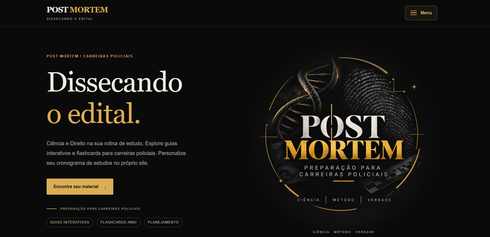
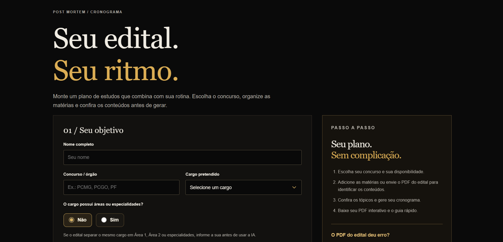

# POST MORTEM | Dissecando o edital

**Plataforma educacional para concursos policiais, com materiais interativos e um gerador de cronogramas personalizados.**

[**Acessar a plataforma oficial**](https://postmorrtem.netlify.app/) · [**Experimentar o gerador**](https://postmorrtem.netlify.app/planner) · [**Instagram**](https://www.instagram.com/post_morrtem/)

## Sobre o projeto

O POST MORTEM une desenvolvimento web, educação e ferramentas de planejamento para candidatos a carreiras policiais. A plataforma reúne um catálogo de materiais digitais e um gerador de cronogramas que considera concurso, cargo, disponibilidade, métodos de estudo, revisões e simulados.

## Funcionalidades apresentadas

- **Catálogo de materiais:** guias interativos, flashcards e produtos digitais.
- **Interface responsiva:** identidade visual em preto e dourado, navegação e menu adaptados para dispositivos móveis.
- **Planejamento personalizado:** formulário com preferências, carga horária, disciplinas e métodos de estudo.
- **Integração com IA:** interface para solicitar a identificação de disciplinas e tópicos a partir de um edital em PDF.
- **Acompanhamento:** fluxo de solicitação e download do cronograma em PDF pela plataforma oficial.

## Tecnologias e arquitetura

- **Frontend:** HTML, CSS e JavaScript.
- **Backend da plataforma oficial:** Python e FastAPI.
- **IA:** integração com API Gemini para auxiliar na leitura de editais.
- **Infraestrutura comercial:** Netlify, Render e serviços de autenticação, créditos e pagamentos.

## Código neste repositório

A pasta [`frontend/`](frontend/) contém **código real da interface web**, extraído de uma versão do projeto, para fins de portfólio e demonstração técnica. As chamadas a serviços de produção foram preservadas apenas como referência de integração; **esta cópia não é uma instalação independente do sistema comercial**. Funcionalidades de IA, autenticação, créditos e geração de PDFs dependem de um backend privado e podem não funcionar ao abrir os arquivos localmente.

O código do backend comercial, as credenciais, os dados de clientes e os arquivos operacionais de implantação **não estão incluídos**.

## Autoria e acesso

Projeto desenvolvido e mantido por **JalKhalifa**. A plataforma e os materiais POST MORTEM são produtos próprios; a disponibilização deste código demonstrativo não concede licença para reprodução comercial dos conteúdos e da marca.

**POST MORTEM | Dissecando o edital**
